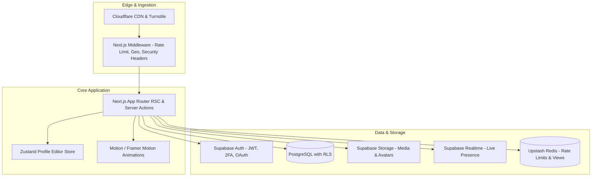

# SILENT.BIO — System Architecture & Implementation Blueprint

## 1. System Overview

SILENT.BIO is a Next.js (App Router) + TypeScript strict application engineered for high-concurrency, low-latency rendering of customizable bio-profiles. It operates on a zero-subscription model with zero paywalls.



---

## 2. Directory Layout & Boundaries

```
silent-bio/
├── app/
│   ├── (auth)/
│   │   ├── login/
│   │   ├── register/
│   │   └── forgot-password/
│   ├── (marketing)/
│   │   ├── page.tsx          # High-craft Landing page
│   │   ├── explore/          # Discovery feed
│   │   ├── themes/           # Community theme gallery
│   │   ├── features/         # Feature breakdown
│   │   └── faq/              # FAQ
│   ├── (dashboard)/
│   │   ├── dashboard/
│   │   │   ├── overview/     # Stats, quick actions, checklist
│   │   │   ├── profile/      # Identity settings
│   │   │   ├── appearance/   # Themes, background, styling
│   │   │   ├── links/        # Social links manager
│   │   │   ├── components/   # Bento & modular widgets
│   │   │   ├── analytics/    # Detailed metrics & charts
│   │   │   ├── media/        # Asset manager
│   │   │   ├── account/      # Email, export, delete
│   │   │   └── security/     # 2FA, sessions
│   ├── editor/               # Fullscreen 3-pane live editor
│   ├── admin/                # Server-verified admin portal
│   ├── api/
│   │   ├── v1/
│   │   │   ├── profiles/[username]/
│   │   │   └── health/
│   │   ├── analytics/
│   │   │   └── collect/
│   │   └── lanyard/[discordId]/
│   ├── [username]/           # Dynamic public profile
│   │   ├── page.tsx
│   │   ├── about/
│   │   ├── links/
│   │   └── gallery/
│   ├── embed/[username]/     # Micro-profile embed card
│   ├── og/[username]/        # Dynamic edge OG generator
│   ├── layout.tsx
│   ├── not-found.tsx
│   └── error.tsx
├── components/
│   ├── ui/                   # Design system primitives (buttons, inputs, dialogs)
│   ├── profile/              # Public profile renderer & components
│   │   ├── ProfileView.tsx
│   │   ├── BackgroundLayer.tsx
│   │   ├── IdentityHeader.tsx
│   │   ├── LinksList.tsx
│   │   ├── MusicPlayer.tsx
│   │   ├── EffectsCanvas.tsx
│   │   └── ComponentGrid.tsx
│   ├── editor/               # Editor panels, live inspector & canvas
│   ├── dashboard/            # Dashboard widgets & charts
│   └── shared/               # Navigation, footer, command palette
├── lib/
│   ├── db/
│   │   ├── schema.ts         # Complete database schema definition
│   │   ├── client.ts         # Supabase client wrapper
│   │   └── seed.ts           # Idempotent seed script
│   ├── security/
│   │   ├── css-sandbox.ts    # Safe CSS validator & property allowlist
│   │   ├── rate-limit.ts     # Redis + in-memory fallback rate limiter
│   │   ├── username-safety.ts# Reserved & lookalike homoglyph filter
│   │   └── sanitize.ts       # HTML & Markdown sanitizer
│   ├── store/
│   │   └── editor-store.ts   # Zustand state with undo/redo & autosave
│   └── themes/
│       └── presets.ts        # 18 built-in themes
├── docs/
│   ├── category-research.md
│   ├── architecture.md
│   └── free-tier-limits.md
└── tests/
    ├── unit/
    ├── security/
    └── e2e/
```

---

## 3. Data Integrity & Security Guarantees

1. **Row Level Security (RLS):**
   - Public can `SELECT` published profiles and approved guestbook entries.
   - Profile owners can `SELECT`, `INSERT`, `UPDATE`, `DELETE` their own profile assets, components, links, and settings.
   - Admins possess server-verified bypass claims via JWT role verification.
   - Zero cross-tenant data leaks.

2. **CSS Sandboxing Engine:**
   - User custom CSS passes through an AST parser.
   - Forbids `@import`, `url()`, `behavior`, `expression()`, `-moz-binding`, `position: fixed` outside card bounds.
   - Scope is isolated exclusively to `.silent-profile-container`.
   - Max size hard-capped at 8 KB.

3. **Privacy-Preserving Analytics Pipeline:**
   - Visitor tracking creates a daily SHA-256 hash using `IP + User-Agent + Daily Server Salt`.
   - Salt rotates every 24 hours UTC. Raw IPs are discarded immediately in memory.
   - Rollup cron consolidates raw pageviews into hourly & daily buckets, guaranteeing sub-500ms query times without ballooning database row count.

---
*Architectural Blueprint confirmed.*
