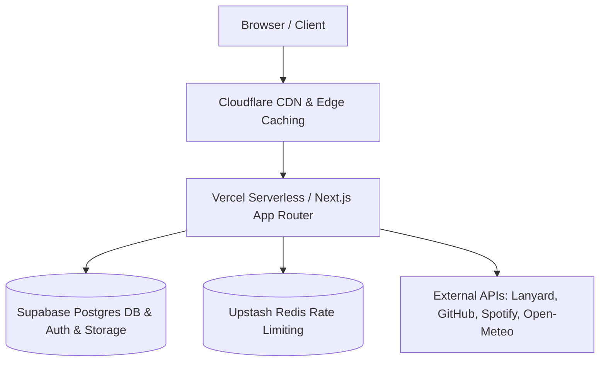

# SILENT.BIO — Stage 0 Category Research & Competitive Analysis

## Executive Summary

The bio-link and personal landing page category has evolved through three distinct eras:
1. **Directory-style portals (2018–2020):** Linktree, Beacons, Bento. Centered on mobile-first utility, rigid lists of pill buttons, and transactional creator monetisation.
2. **Subculture & Dark-Aesthetic Hubs (2021–2024):** guns.lol, fakecrime.bio, alias.rip. Shifted from utilitarian business links to raw personal expression, digital flexing, counter-culture identities, audio playback on click, custom visual effects, and gaming/community presence.
3. **The Post-Clutter Modern Stage (2025+ — SILENT.BIO):** Reclaiming digital presence with calm, restrained elegance, zero paywalls or artificial feature gating, strict performance budgets, privacy-first analytics, and architectural robustness.

This document dissects the mechanics, successes, failures, and structural limits of the leading subculture bio platforms (`guns.lol`, `fakecrime.bio`, `alias.rip`), establishes SILENT.BIO's distinct value proposition, and maps the exact free-tier ceilings of the production stack.

---

## 1. Deep-Dive Platform Breakdown

### 1.1 guns.lol

#### First 3-Second Impression
- **Entry & Atmosphere:** Dark, aggressive, high-contrast, heavily stylized. Most user pages trigger an explicit splash overlay ("Click to Enter") with custom cursors, ambient particle effects (snow, embers, stars), and immediate background audio playback.
- **Density & Motion:** High visual density. Dense typography, floating icon badges, Discord status pills, and interactive canvas overlays. Motion is loud: glowing CSS animations, text shimmer, continuous particles, and 3D card tilt on pointer movement.

#### Most-Reached-For Customisation Options
- **Backgrounds:** Looping anime or hyperpop WebM video backgrounds, high-noise textures, or dark muted wallpapers.
- **Audio:** Embedded MP3 playback with floating mini-player, custom scrubbers, volume memory, and synced visualizers.
- **Badges & Visual Identity:** Discord integration (via Lanyard), animated glow borders, custom cursor trails, glassmorphic card backgrounds.
- **Link Styles:** Rounded cards with hover elevation, icon-left layout, glow accents matching the profile's primary hex code.

#### Identity Mechanics
- **UIDs:** Low-number UIDs (e.g. UID #12, UID #104) treated as status symbols. Early accounts and single-digit usernames command prestige.
- **Badges:** Donator badges, verified badges, staff shields, booster gems, and custom community awards.
- **View Counters:** Prominently featured on profile headers with animated rolling numbers.
- **Presence:** Real-time Discord presence showing active status, game title, Spotify track, and voice channel state.

#### Onboarding Speed
- Registration to live profile takes ~45–60 seconds. Quick email or Discord OAuth, immediate username reservation, drop into an active editor with a default theme pre-applied.

#### Weaknesses & Friction Points
- **Aggressive Paywalls:** Premium tiers gate essential features (custom domain mapping, higher file upload caps, multiple audio tracks, remove platform branding, badge customization).
- **Performance Bloat:** Heavy uncompressed video backgrounds, multiple unthrottled canvas animation loops, unoptimised custom fonts causing severe layout shifts (CLS > 0.3) and high CPU/battery consumption on mobile.
- **Abuse Surface:** High rate of malicious redirects, deceptive link names, phishing landing pages, and unmoderated audio/video media uploads.

---

### 1.2 fakecrime.bio

#### First 3-Second Impression
- **Entry & Atmosphere:** Hyper-underground, hacker/cyber-editorial aesthetic. Monochrome or phosphor-green/monochromatic palettes, heavy CRT scanlines, terminal-style monospace fonts, and stark ASCII art flourishes.
- **Density & Motion:** Extreme density. Information-packed bento grids, raw stats, cryptographic key fingerprints, and fast typewriter animations.

#### Most-Reached-For Customisation Options
- **Backgrounds:** CRT phosphor scanlines, SVG dither patterns, low-fi monochrome gifs, and pure OLED black (#000000).
- **Audio:** Vaporwave, underground trap, drill, or ambient synthesizer tracks tied to custom ASCII-styled media controls.
- **Badges & Visual Identity:** Hacker badges, encrypted key references, terminal status badges, custom Discord rich presence.
- **Link Styles:** Monospaced bracketed links (`[ 01 // GITHUB ]`), minimalist borders with 0px radius, stark invert-on-hover effects.

#### Identity Mechanics
- **UIDs & Registration Sequences:** Incremental sequential user IDs displayed as hex addresses or zero-padded numbers (`UID 0x004F`).
- **Reputation & Badges:** Exclusive invite badges, cryptographic verification markers, and custom profile title tags.
- **Counters:** Terminal-style visitor counters and session logs.

#### Onboarding Speed
- Often gated behind invitation codes or strict verification, raising friction (2–5 minutes). Once inside, editor is utilitarian but steep in learning curve.

#### Weaknesses & Friction Points
- **Accessibility Failures:** Severe contrast issues (dark grey on black), unreadable font sizes (8–10px monospace), disregard for `prefers-reduced-motion`.
- **Mobile Unfriendly:** Fixed-width terminal layouts that break below 400px viewport, overlapping floating widgets, and broken touch gestures.
- **Gatekeeping & Instability:** Frequent domain migrations, inconsistent server uptime, and elitist tiering that restricts simple layout changes to paid members.

---

### 1.3 alias.rip

#### First 3-Second Impression
- **Entry & Atmosphere:** Polished subculture aesthetic. Balances dark-mode mystique with contemporary web engineering standards. Clean glassmorphism, refined typography, and smooth micro-interactions.
- **Density & Motion:** Medium density. Well-balanced card layouts, subtle particle canvas implementations, smooth spring-based physics for hover and card interactions.

#### Most-Reached-For Customisation Options
- **Backgrounds:** Smooth gradient meshes, frosted glass backdrops (`backdrop-blur-md`), ambient lighting orbs, and high-quality photography.
- **Audio:** Clean floating audio capsule with scrub bar, track details, and autoplay after splash click.
- **Badges & Visual Identity:** Verified checkmarks, premium crown icons, custom SVG profile badges, and rich bio cards with interactive tabs.
- **Link Styles:** Bento-style mixed cards (1x1 square social tiles alongside 2x1 rich preview cards for featured content).

#### Identity Mechanics
- **Username System:** Clean claim process, protected short handles (3-letter or single-word handles held for premium).
- **View Counters & Stats:** Profile views, unique link clicks, and time-on-page analytics summary visible to profile owner.
- **Presence & Integrations:** Spotify player integration, Steam showcase, and Discord Lanyard integration.

#### Onboarding Speed
- ~90 seconds. Clean onboarding wizard: choose handle -> pick starter theme -> add top 3 social links -> publish.

#### Weaknesses & Friction Points
- **Tiered Commercialization:** "Pro" and "VIP" tags constantly nudge the user. Free profiles feel deliberately neutered to drive upsells.
- **Vendor Lock-in:** No straightforward way to export profile data, back up configurations, or migrate themes.
- **Complex Navigation:** Fragmented dashboard menus where settings, links, analytics, and themes are dispersed across disparate pages.

---

## 2. Synthesis: Mechanics to Adopt, Fix, and Pioneer

| Dimension | Existing Platforms (guns.lol, fakecrime, alias.rip) | What Fails (The Trap) | SILENT.BIO Solution (What We Build) |
| :--- | :--- | :--- | :--- |
| **Monetisation & Gating** | Tiered locks: Pro, VIP, Boosts. Essential features paywalled behind \$5–\$15/mo. | Frustrates users; creates second-class profiles with ugly badges and watermarks. | **100% Free Forever.** Zero tiers, zero paywalls, zero locked features. Every feature is unlocked for every user from day one. |
| **Visual Atmosphere** | Aggressive, chaotic, loud glows, rainbow RGB gradients, visual overstimulation. | Disorganized, tacky, dated within months; causes visual fatigue. | **Calm, Restrained, High-Craft.** Dark-first design system (`#08090B`), subtle `#A5A5FF` accent, Emil Kowalski animation rules, 4px grid. |
| **Performance & Load Times** | Heavy 40MB looping video assets, unthrottled canvas loops, 3–6s LCP. | Terrible battery drain, mobile stutter, poor SEO and slow initial load times. | **Target: 95+ Lighthouse, LCP < 2.0s.** Poster-first video, frame-budgeted particle canvas, Next.js ISR/SSR, code-splitting. |
| **Identity Mechanics** | Low UIDs as clout, verified badges reserved for donors or staff. | Pay-to-win identity ecosystem; artificial scarcity. | **Merit & Expression Based.** Authentic UID assignment, earned & community badges, Discord Lanyard, Spotify now-playing. |
| **Audio Mechanics** | Audio autoplay often intrusive or breaks browser policies without fallback. | Sudden audio blasts, browser blocking audio context, confusing mute states. | **Click-to-Enter Splash.** Clear intent gate unlocking Web Audio API cleanly, remembered volume, graceful playback fallback. |
| **Component Extensibility** | Static link lists or basic social icons. | Rigid presentation; user cannot structure rich content or custom modular layouts. | **30+ Modular Components.** Bento grid, markdown blocks, sandboxed HTML, GitHub activity, live streams, guestbook, poll, weather. |
| **Privacy & Analytics** | Tracking cookies, fingerprinting, intrusive cross-site scripts. | Violates privacy regulations; bloats page execution. | **Privacy-First Ingestion.** Zero cookies, daily salted rotating visitor hash, no raw IP retention, Realtime presence via Supabase. |
| **Security & Safety** | Frequent phishing, malicious redirects, unmoderated guestbooks. | Community reputation destroyed by malicious actors abusing shortlinks. | **Zero-Trust Security.** Sandboxed CSS allowlist, strict CSP, SSRF-safe URL checking, rate-limited guestbooks with moderation queue. |

---

## 3. Third-Party Stack & Free-Tier Operational Limits

SILENT.BIO is designed to run in production at **zero dollar infrastructure cost** while supporting thousands of active profiles using industry-standard free tiers:

### 3.1 Stack Services & Free Quotas

| Service | Component Role | Free-Tier Quota & Limits | Operational Strategy for SILENT.BIO |
| :--- | :--- | :--- | :--- |
| **Vercel** | Hosting, Edge Middleware, Next.js App Router | - 100 GB Bandwidth / month - 100,000 Serverless Function invocations / day - 1,000,000 Edge Requests / month | - ISR (Incremental Static Regeneration) with 60s stale-while-revalidate for profile pages. - Route cache for public pages; fast edge-served responses. |
| **Supabase** | PostgreSQL, Auth, Row Level Security, Storage, Realtime | - 500 MB Database storage - 50,000 Monthly Active Users (Auth) - 1 GB File Storage - 200 concurrent Realtime connections | - Strict image optimisation & compression before storage upload. - Analytics rollup tables (hourly/daily rollups) to keep row storage compact. - Presence multiplexing for active profile views. |
| **Upstash Redis** | Distributed Rate Limiting & Transient Cache | - 10,000 commands / day (free tier) - In-memory LRU fallback included for local dev | - Sliding-window rate limiting for mutations (auth, profile updates, guestbook, contact form). - Read requests bypass Redis via Edge/HTTP caching headers. |
| **Cloudflare** | DNS, CDN, Edge Caching, Turnstile Anti-Bot | - Unlimited DNS & CDN caching - Turnstile: 1,000,000 challenges / month free | - Cache static assets, profile HTML, and avatar/banner media at edge. - Honeypot + Turnstile on registration and sensitive forms. |
| **Lanyard API** | Real-time Discord Rich Presence | - 100% Free public community API & WebSocket (`api.lanyard.rest`) | - Client-side WebSocket hook with REST fallback (`/v1/users/{id}`). Graceful degradation if user not in Lanyard server. |
| **GitHub REST API** | Developer Activity & Pinned Repos | - 60 unauthenticated requests / hour per IP - 5,000 req/hr with personal access token | - Server-side caching of user activity for 15 minutes. Stale-while-revalidate to stay well below limits. |
| **Spotify Web API** | Now-Playing & Album Artwork | - Free Developer Tier (unlimited development quota for standard endpoints) | - Public oEmbed preview support (no API key needed) + optional user OAuth for live playback state. |
| **Open-Meteo** | Weather Widget | - Free non-commercial use up to 10,000 calls / day (no API key required) | - Client-side geo-coordinates lookup with 30-minute client cache. |

---

## 4. Architectural Rules for SILENT.BIO

1. **Every Feature is Free:** No premium flags in the database schema. No upsell modals. Every profile has full access to CSS overrides, video backgrounds, custom badges, audio playlists, and unlimited links.
2. **Predictable Fallbacks:** If any third-party service (Lanyard, Spotify, Redis) is unavailable or rate-limited, the UI degrades seamlessly without broken images, console errors, or blank widgets.
3. **Strict Design Tokens:** Absolute compliance with the design tokens: `#08090B` base background, `#101114` surface, `#15171B` elevated, `#A5A5FF` accent, Geist Sans and Geist Mono typography.
4. **Motion with Intent:** Follow Emil Kowalski motion constraints — cubic-bezier entrances, micro-interaction transitions between 150ms–250ms, no unnecessary scale(0) animations, and strict `prefers-reduced-motion` compliance.

---
*Document complete. Ready for Stage 1: Setup, Architecture, Schema, and RLS.*
